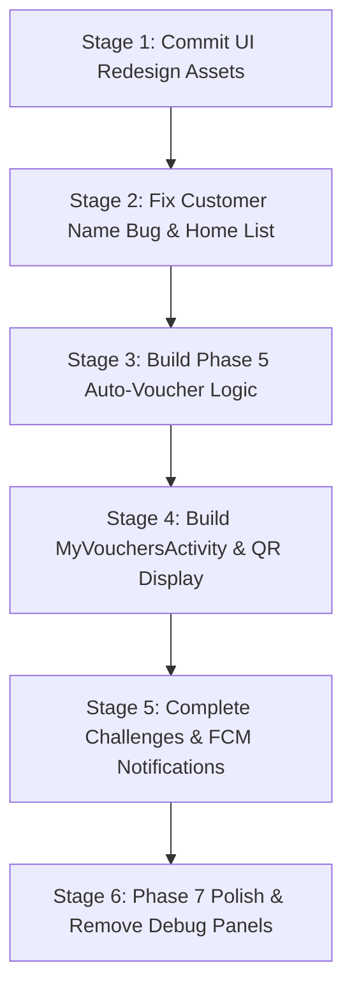

# SapotLokal — Comprehensive Mobile App Progress Report

_Generated: October 25, 2026_  
_Repository:_ `c:\dev\sapotlokal`  
_Current Active Branch:_ `feature/games-merge`  
_Build Status:_ `assembleDebug` **PASSING** (Gradle 9.6.0, AGP 9.4.0, JDK 21 / Android Studio JBR)

---

## 1. Executive Summary & Progress Checklist

The SapotLokal application is an Android-native loyalty platform connecting local merchants (Shop Owners / Vendors) with nearby shoppers (Customers). The project is built following the architecture and phases outlined in `SAPOTLOKAL_BUILD_GUIDE.md` and `docs/GAMES_MERGE_BUILD_GUIDE.md`.

### Phase Status Overview

| Phase | Phase Name | Status | Summary of Progress |
| :--- | :--- | :---: | :--- |
| **Phase 1** | Foundations & Data Model | **DONE (100%)** | Firebase Auth & Realtime Database connected (regional URL `asia-southeast1`). Data models in `Models.kt`. Single configuration class in `AppConfig.kt`. Base theme & `SplashActivity` router functional. |
| **Phase 2** | Accounts & Role-Based Sign-Up | **DONE (100%)** | `RolePickerActivity`, `SignUpCustomerActivity`, `SignUpVendorActivity`, `LoginActivity`. Immutable role locking via Firebase Security Rules. |
| **Phase 3** | Customer Core Loop | **DONE (90%)** | `CustomerHomeActivity` with live points listener, `FindShopsActivity` with dynamic vendor & balance listing, `ScanActivity` with CameraX + ML Kit barcode scanning + `PointRepository.recordShopVisit()`. |
| **Phase 4** | Shop Owner Core Loop | **DONE (100%)** | `VendorHomeActivity`, `ShowQrActivity` with 60s rotating TOTP-style QR, `RewardRulesActivity` + `AddEditRuleActivity`, `ScanToRedeemActivity` with CameraX scan & manual code entry fallback + atomic redemption. |
| **Phase 5** | Rewards & Vouchers | **INCOMPLETE (25%)** | Redemption side works (`VoucherRepository.validateVoucherForRedemption()`, `redeemVoucher()`), but **Customer-side auto-voucher creation is not yet triggered**, and `MyVouchersActivity` does not exist. |
| **Phase 6** | Games, Levels & Challenges | **PARTIAL (45%)** | **Mini Games merged**: `GamesMenuActivity`, `SpinWheelActivity` (custom `WheelView`), `MemoryMatchActivity`, server-side daily limits enforced via `GamesRepository`. **Not started**: Challenges list, level-up animations, FCM push notifications, Shop settings edit, Shop statistics. |
| **Phase 7** | Polish & Testing | **NOT STARTED (10%)** | Debug helper panels remain in `ScanActivity` and `ShowQrActivity`. Unhandled edge cases (offline error banners, empty states). Uncommitted UI redesign files. |

---

## 2. Detailed Checklist: What Has Been Done vs. What Is Not Done Yet

### 2.1 Completed Features (`[x]`)

- [x] **Firebase Integration:** Connected to Firebase Auth and regional Realtime Database (`https://sapotlokal-cd37b-default-rtdb.asia-southeast1.firebasedatabase.app`).
- [x] **Security Rules (`docs/firebase-rules.json`):** Rules for `/users`, `/vendors`, `/qrcodes`, `/points`, `/vouchers`, `/voucherUsers`, and `/games`. Role field is write-once.
- [x] **Centralized Configuration (`AppConfig.kt`):** Single source of truth for point increments, QR rotation timings, daily limits, level thresholds, and game reward parameters.
- [x] **Customer Authentication:** Email/password registration and login; customer role stored in `/users/{uid}`.
- [x] **Vendor Authentication:** Business sign-up capturing shop name, category, address, and SSM registration number; sequential atomic creation of `/users` and `/vendors` records.
- [x] **Role-Based Routing:** `SplashActivity` and `LoginActivity` inspect user role from the live database and route directly to Customer Home or Vendor Home.
- [x] **Customer Points & Level System:** `PointRepository` calculates lifetime earned points (for levels) and per-shop balances. `CustomerHomeActivity` attaches a live `ValueEventListener` to `/points`.
- [x] **Shop QR Code Generation (Vendor):** `ShowQrActivity` generates and displays a rotating QR code using ZXing core with a 60-second `CountDownTimer`, persisting active codes to `/qrcodes`.
- [x] **Shop QR Code Scanning (Customer):** `ScanActivity` uses CameraX and Google ML Kit Barcode Scanning to scan shop QRs, checks validity against `/qrcodes`, and writes a `shop_visit` point row (+10 points).
- [x] **Shop Discovery:** `FindShopsActivity` queries `/vendors` and merges with customer points to display available local shops with their addresses and user's balance.
- [x] **Reward Rules Management (Vendor):** `RewardRulesActivity` and `AddEditRuleActivity` allow vendors to create, edit, and toggle active/inactive reward rules stored at `/vouchers`.
- [x] **Voucher Redemption (Vendor):** `ScanToRedeemActivity` supports scanning customer voucher codes via CameraX or typing them manually. It validates code existence, matching vendor, active status, expiry, and sufficient balance.
- [x] **Atomic Ledger Redemption:** `VoucherRepository.redeemVoucher()` atomically marks the voucher `used` and inserts a `redemption` entry in `/points` in a single multi-path `updateChildren()` call.
- [x] **Mini Games Engine (Phase 6):**
  - `GamesMenuActivity`: Hub displaying live daily spin availability and memory match point counters.
  - `SpinWheelActivity`: Interactive animated wheel (`WheelView`) granting random points (5 to 50 pts) once per calendar day (enforced against `/games` live rows in KL timezone).
  - `MemoryMatchActivity`: Card flip matching game granting 20 points per win up to a 60-point daily cap.
  - `GamesRepository`: Records plays atomically to both `/games` and `/points` nodes.

---

### 2.2 Not Yet Completed (`[ ]`)

#### Phase 5 — Rewards & Vouchers
- [ ] **Auto-Voucher Generation Engine:**
  - Logic to evaluate reward rules (`/vouchers`) whenever points are awarded to a customer.
  - Automatically instantiate a `VOUCHER_USER` row when a customer's per-shop balance meets or exceeds an active rule's `pointsRequired`.
  - Prevent duplicate voucher generation if an active voucher for that rule already exists.
  - Store a snapshot of `pointsRequiredSnapshot` and `voucherExpiryDate` (`now + AppConfig.VOUCHER_EXPIRY_DAYS`).
- [ ] **My Vouchers Screen (`MyVouchersActivity`):**
  - Customer view listing all active vouchers grouped by shop.
  - Highlight the highest-value qualifying voucher as `"Best Choice"`.
  - Display QR code (via ZXing) and human-readable alphanumeric code for the shop owner to scan or type.
  - Locked vs. active states: if points were spent on another voucher, unaffordable vouchers remain visible but locked.
  - Disappearance of used/expired vouchers from active view.

#### Phase 6 — Remaining Items
- [ ] **Challenges Engine:**
  - Database schema and repository for `/challenges` and `/userChallenges`.
  - Customer Challenges UI showing available missions (e.g., "Visit 3 shops this week", "Play 5 games").
  - Automated progress incrementing and single-claim reward distribution.
- [ ] **Push Notifications (FCM):**
  - Complete `SapotFcmService.kt` implementation.
  - Save FCM registration tokens to `/users/{uid}/fcmToken`.
  - Trigger local or FCM notifications on: Level-up, new auto-voucher earned ("Your reward is ready!"), challenge completion.
- [ ] **Vendor Profile & Shop Settings (`ShopSettingsActivity`):**
  - Allow vendors to edit shop name, category, description, and address.
- [ ] **Vendor Analytics & Stats (`VendorStatsActivity`):**
  - Daily visit counts, total points awarded, and vouchers redeemed overview.

#### Phase 7 — Polish & Testing
- [ ] **Remove Debug Panels:**
  - Delete manual QR string debug injector in `ScanActivity.kt`.
  - Delete raw debug text preview in `ShowQrActivity.kt`.
- [ ] **Network & Error Handling:**
  - Global offline detection bar when disconnected.
  - Graceful fallback for camera permission denials with guidance to app settings.
- [ ] **Figma UI Harmonization:**
  - Complete adoption of SapotLokal design system tokens (`colors.xml`, typography, curved cards).

---

## 3. Inventory: Pages & Components Missing

| Missing Page / Component | Target Package / Directory | Purpose & Requirements | Priority |
| :--- | :--- | :--- | :---: |
| **`MyVouchersActivity`** | `ui.customer.MyVouchersActivity` | Customer screen to view earned reward vouchers grouped by vendor, displaying QR codes for redemption. | **HIGH (Blocker for Phase 5)** |
| **`VoucherAdapter` & `item_voucher_card.xml`** | `ui.customer` / `res/layout` | Card layout showing voucher name, shop, expiry date, QR code, and "Best Choice" badge. | **HIGH** |
| **Voucher Generator Hook** | `data.repository.VoucherRepository` | Triggered inside `PointRepository.recordShopVisit()` to scan active rules and insert `voucherUsers` records. | **HIGH** |
| **`CustomerWelcomeActivity`** | `ui.customer.CustomerWelcomeActivity` | Onboarding/welcome screen. Layout `activity_customer_welcome.xml` is already designed but not wired to any Activity or manifest entry. | **MEDIUM** |
| **Customer Home Dynamic Shops List** | `ui.customer.CustomerHomeActivity` | Currently `activity_customer_home.xml` includes a single static `item_shop_card.xml`. Needs a horizontal or vertical `RecyclerView` connected to `ShopAdapter`. | **MEDIUM** |
| **Customer Profile Screen** | `ui.customer.ProfileActivity` or Modal BottomSheet | Profile overview showing customer details, edit name, preferences, language selector, and logout (currently just a popup menu). | **MEDIUM** |
| **`ChallengesActivity`** | `ui.customer.ChallengesActivity` | UI displaying active challenges, progress bars, and reward claim buttons. | **MEDIUM** |
| **`ShopSettingsActivity`** | `ui.vendor.ShopSettingsActivity` | Vendor screen allowing shop owners to edit shop details, address, and category. | **LOW** |
| **`VendorStatsActivity`** | `ui.vendor.VendorStatsActivity` | Statistics dashboard showing customer footfall and voucher redemption counts. | **LOW** |

---

## 4. Current Bugs, Flaws, and Technical Debt

### 1. `displayName` Bug in Customer Home (`CustomerHomeActivity.kt:56`)
- **Problem:** `CustomerHomeActivity` displays:
  ```kotlin
  val displayName = user.displayName?.split(" ")?.firstOrNull() ?: "there"
  binding.tvGreeting.text = "Morning, $displayName ☀"
  ```
  However, in `SignUpCustomerActivity.kt`, the account is created via `auth.createUserWithEmailAndPassword()` and the user's name is saved only to `/users/{uid}/userName` in the Realtime Database. Firebase Auth's `user.displayName` is never populated!
- **Symptom:** The greeting always displays `"Morning, there ☀"`.
- **Fix:** Either call `user.updateProfile(userProfileChangeRequest { displayName = name })` upon registration, or read the customer's name from `/users/{uid}/userName`.

### 2. Hardcoded UI in New Customer Home (`activity_customer_home.xml`)
- **Problem:** The recent redesign in `activity_customer_home.xml` hardcoded text from Figma mockup data:
  - Shop name `"Kopi Lorong"`
  - Subtitle `"Bangsar · Neighbourhood café"`
  - Static shop card (`@layout/item_shop_card`) with hardcoded `"Roti Pagi"`, `"85 pts"`.
- **Symptom:** The screen mixes real customer lifetime points with a hardcoded mock shop card and hardcoded featured cafe labels, rather than loading the customer's top visited shop or nearby shops.

### 3. Git Working Tree State (Untracked UI Resources)
- **Problem:** On branch `feature/games-merge`, 27 files are untracked (including `activity_customer_welcome.xml`, `item_shop_card.xml`, `layout_customer_bottom_nav.xml`, and various vector icons and drawables).
- **Risk:** Anyone checking out or pulling this branch without these files will encounter fatal XML inflate build failures.

### 4. Stubbed FCM Implementation (`SapotFcmService.kt`)
- **Problem:** The service is declared in `AndroidManifest.xml` and has an empty class body. If a notification payload is dispatched, nothing happens. No FCM registration token is synchronized to `/users/{uid}`.

### 5. Debug Code Remaining in Production Paths
- **`ScanActivity.kt`**: Contains `setupDebugPanel()` allowing manual string input to fake camera scans.
- **`ShowQrActivity.kt`**: Contains `tvDebugValue` displaying the raw TOTP QR string directly on screen.

### 6. Environment Setup Note (`JAVA_HOME`)
- **Problem:** Running `./gradlew` from an external terminal or command line fails if `JAVA_HOME` is unset.
- **Solution:** Set `JAVA_HOME` to Android Studio's bundled runtime:
  ```powershell
  $env:JAVA_HOME = "C:\Program Files\Android\Android Studio\jbr"
  ```

---

## 5. Architectural Reference & Guidelines for Further Coding

When implementing the next stages of the codebase, adhere strictly to these architectural patterns:

### 1. Database URL Rule
Always instantiate Firebase Realtime Database with the regional URL:
```kotlin
FirebaseDatabase.getInstance(AppConfig.DATABASE_URL).reference
```
*Never call `FirebaseDatabase.getInstance()` without parameters; it will fail in asia-southeast1.*

### 2. Append-Only Points Ledger (Rule 9)
Points are never updated as a single mutable balance field. All point additions and subtractions are atomic ledger rows written under `/points`:
- **Earn:** `pointEarnedAmount > 0`, `pointRedeemedAmount = 0`
- **Redeem:** `pointEarnedAmount = 0`, `pointRedeemedAmount > 0`
- **Customer Shop Balance:** `sum(pointEarnedAmount) - sum(pointRedeemedAmount)` for that specific `vendorID`.
- **Customer Lifetime Level:** `sum(pointEarnedAmount)` across all rows (including game points where `vendorID = ""`).

### 3. Atomic Multi-Path Writes
Whenever an operation affects multiple entities (e.g., game points + game play, or voucher status + redemption points), use a single `db.updateChildren(updates)` call to avoid partial failures.

### 4. Single Source of Truth (`AppConfig.kt`)
Do not hardcode magic numbers (such as point values, cooldown intervals, or rotation seconds) in Activities. Reference `AppConfig.kt`.

---

## 6. Recommended Next Steps & Roadmap



1. **Commit Current Changes:**
   - Stage and commit the untracked icons, drawables, and layouts on `feature/games-merge`.
2. **Fix Customer Home Greeting & Dynamic Shops:**
   - Update `SignUpCustomerActivity` to set `displayName` or fetch `userName` from `/users/{uid}`.
   - Replace the static `<include layout="@layout/item_shop_card" />` with a dynamic `RecyclerView` or list binder.
3. **Implement Phase 5 (Auto-Voucher Engine):**
   - Add threshold checking function in `VoucherRepository` called after successful `PointRepository.recordShopVisit()`.
   - Create `VOUCHER_USER` records with expiry date calculation.
4. **Implement `MyVouchersActivity`:**
   - Build customer voucher list view with ZXing QR display modal for shop owner redemption.
5. **Implement Phase 6 Challenges & Settings:**
   - Define `/challenges` and build `ChallengesActivity`.
   - Build `ShopSettingsActivity` for vendors.
6. **Phase 7 Polish:**
   - Remove debug panels in `ScanActivity` and `ShowQrActivity`.
   - Handle edge-case dialogs for network dropouts.

