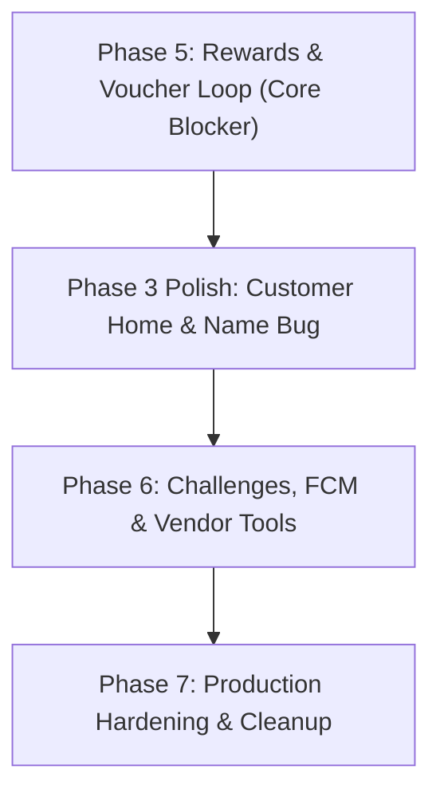

Here is the complete, structured Markdown document you can save as **`REMAINING_PHASES_ROADMAP.md`** in your project root or `docs/` folder. It provides a step-by-step blueprint to bring SapotLokal from its current state to 100% completion.

---

```markdown
# SapotLokal — Remaining Phases Implementation Roadmap

_Target Branch:_ `feature/games-merge` or `main`  
_Architecture:_ Native Android (Kotlin) + Firebase Auth + Regional Realtime Database (`asia-southeast1`)  
_Design System:_ Material 3 + SapotLokal Color Tokens

---

## 1. Executive Status Overview

| Phase | Description | Status | Remaining Work |
| :--- | :--- | :---: | :--- |
| **Phase 1** | Foundations & Firebase Config | **100%** | None. Base config locked. |
| **Phase 2** | Accounts & Role-Based Auth | **100%** | None. Separated Customer/Vendor Login & Registration complete. |
| **Phase 3** | Customer Core Loop & Discovery | **100%** | None. Greeting display name fixed; dynamic recent shops bound on Customer Home. |
| **Phase 4** | Vendor Core Loop (QR & Scan) | **100%** | None. 60s rotating QR & Scan-to-redeem verified. |
| **Phase 5** | Rewards & Voucher Engine | **100%** | None. Auto-voucher engine, `MyVouchersActivity`, ZXing QR generator, and Home integration complete. |
| **Phase 6** | Challenges, FCM & Vendor Management | **100%** | None. Challenges engine & UI, FCM token sync & notifications, Vendor settings & Analytics dashboard complete. |
| **Phase 7** | Production Polish & Cleanup | **10%** | Remove debug UI panels, handle offline banners, git asset hygiene. |

---

## 2. Phase-by-Phase Implementation Plan



---

### Phase 5: Rewards & Vouchers System (Priority 1 — Blocker)

> **Objective:** Close the core loyalty loop. When customers earn points, eligible vouchers must be auto-generated in `/voucherUsers`, and customers must have a screen to view and present voucher QR codes to vendors.

#### Task 5.1 — Auto-Voucher Generation Engine
* **Target File:** `data/repository/VoucherRepository.kt` & `data/repository/PointRepository.kt`
* **Trigger Point:** Immediately following a successful `PointRepository.recordShopVisit()` or point grant.
* **Logic:**
  1. Calculate customer's current balance for the visited `vendorID`:  
     `balance = sum(pointEarnedAmount) - sum(pointRedeemedAmount)`.
  2. Query `/vouchers` where `vendorID == currentVendorID` and `voucherIsActive == true`.
  3. For every rule where `balance >= pointsRequired`:
     * Check `/voucherUsers` to ensure an active/unused voucher for this `(userID, voucherID)` doesn't already exist.
     * If absent, insert a new `VoucherUser` record:
       ```json
       {
         "voucherUserID": "vu_<pushId>",
         "userID": "<customerUid>",
         "vendorID": "<vendorId>",
         "voucherID": "<ruleId>",
         "voucherTitle": "<ruleTitle>",
         "pointsRequiredSnapshot": 50,
         "voucherCode": "VOUCH-XXXXXX",
         "voucherStatus": "ACTIVE",
         "voucherExpiryDate": "<timestamp_now_plus_AppConfig.VOUCHER_EXPIRY_DAYS>",
         "createdAt": "<timestamp>"
       }
       ```

#### Task 5.2 — Voucher Card UI & Adapter
* **Target Files:**
  * `res/layout/item_voucher_card.xml`
  * `ui/customer/VoucherAdapter.kt`
* **UI Features:**
  * Displays: Shop Name, Reward Title, Points Value, Expiry Date.
  * `"Best Choice"` badge highlighted on the highest-value qualifying voucher for that shop.
  * Status indicator: `Active`, `Redeemed`, or `Locked` (if total customer balance dipped below `pointsRequiredSnapshot` due to another redemption).

#### Task 5.3 — Customer "My Vouchers" Screen
* **Target Files:**
  * `res/layout/activity_my_vouchers.xml`
  * `ui/customer/MyVouchersActivity.kt`
* **Functionality:**
  * List all user vouchers from `/voucherUsers` grouped or filterable by Shop.
  * Tapping a voucher opens a bottom sheet or modal dialog displaying:
    * High-resolution QR code generated via ZXing (`BarcodeFormat.QR_CODE`) containing `voucherCode`.
    * Large human-readable alphanumeric code (fallback for manual entry in `ScanToRedeemActivity`).
    * Expiry timer and shop address.

#### Task 5.4 — Connect Customer Home to Vouchers
* Add navigation action on Customer Home (Quick Action button & Bottom Navigation) leading to `MyVouchersActivity`.

---

### Phase 3 Polish: Customer Home & Profile Fixes (Priority 2)

> **Objective:** Fix mock/hardcoded UI in `CustomerHomeActivity` and fix the customer greeting bug.

#### Task 3.1 — Customer Display Name Fix
* **Problem:** `CustomerHomeActivity.kt:56` calls `user.displayName`, which is never populated during sign-up, defaulting to `"Morning, there ☀"`.
* **Fix Options (Apply either):**
  1. In `SignUpCustomerActivity.kt`, execute `user.updateProfile { displayName = name }` upon Firebase user creation.
  2. In `CustomerHomeActivity.kt`, attach a single-event listener to `/users/{uid}/userName` and bind real customer name to `binding.tvGreeting`.

#### Task 3.2 — Dynamic Shop Cards on Customer Home
* **Problem:** `activity_customer_home.xml` includes a hardcoded static layout (`@layout/item_shop_card`) with mockup text ("Kopi Lorong", "85 pts").
* **Fix:**
  * Replace the static `<include>` with a horizontal or vertical `RecyclerView` (`rvRecentShops`).
  * Query customer's recent visits from `/points` and fetch matching vendor metadata from `/vendors`.
  * Display real shop names, categories, and customer balances.

---

### Phase 6: Challenges, Notifications & Vendor Tools (Priority 3)

> **Objective:** Gamification loop completion and merchant self-service tools.

#### Task 6.1 — Challenges Engine
* **Database Paths:** `/challenges` (definitions) and `/userChallenges/{uid}/{challengeId}` (user progress).
* **Screens:**
  * `ui/customer/ChallengesActivity.kt` & `item_challenge_card.xml`.
* **Sample Challenges:**
  * "Local Explorer": Visit 3 different shops (+30 bonus pts).
  * "Game Master": Play Spin Wheel & Memory Match 3 days in a row (+50 bonus pts).
* **Logic:** Progress increments on shop scan or game completion; one-time claim button writes bonus points to `/points`.

#### Task 6.2 — FCM Push Notifications Service
* **Target File:** `service/SapotFcmService.kt`
* **Functionality:**
  * Override `onNewToken(token: String)`: Save token to `/users/{uid}/fcmToken`.
  * Override `onMessageReceived(remoteMessage: RemoteMessage)`: Build native Android notifications with `NotificationCompat.Builder`.
  * Channels:
    * `channel_rewards`: "Your voucher is ready! You reached 50 points at Kopi Lorong."
    * `channel_levels`: "Congratulations! You reached Level 2 (Silver Sapot)."

#### Task 6.3 — Vendor Shop Settings
* **Target File:** `ui/vendor/ShopSettingsActivity.kt`
* **Functionality:**
  * Allow shop owners to view and edit: `vendorName`, `vendorCategory`, `vendorAddress`, and description.
  * Updates `/vendors/{vendorId}` in Realtime Database.

#### Task 6.4 — Vendor Analytics Dashboard
* **Target File:** `ui/vendor/VendorStatsActivity.kt`
* **Functionality:**
  * Total customer footfall (count of distinct `userID` entries in `/points` for this `vendorID`).
  * Total vouchers redeemed to date.
  * Daily points distributed chart/counter.

---

### Phase 7: Production Hardening, Polish & Cleanup (Priority 4)

> **Objective:** Remove debug backdoors, handle edge cases, and ensure release readiness.

#### Task 7.1 — Remove Debug Test Hooks
* In `ScanActivity.kt`: Remove `setupDebugPanel()` and debug input field.
* In `ShowQrActivity.kt`: Remove `tvDebugValue` raw token preview text.

#### Task 7.2 — Network & Offline Resilience
* Implement a persistent top snackbar or banner that detects `ACCESS_NETWORK_STATE` changes and alerts user when offline.
* Graceful fallback when Camera permission is permanently denied (redirect to App Settings dialog).

#### Task 7.3 — Git Hygiene & Design System Alignment
* Stage and commit all 27 untracked drawables, icons, and layout files on `feature/games-merge`.
* Ensure colors use unified palette defined in `res/values/colors.xml`.

---

## 3. Database Schema Reference for New Nodes

### `/voucherUsers/{voucherUserID}`
```json
{
  "voucherUserID": "vu_abc123",
  "userID": "usr_cust_001",
  "vendorID": "usr_vend_002",
  "voucherID": "vouch_rule_999",
  "voucherTitle": "Free Teh Tarik",
  "pointsRequiredSnapshot": 30,
  "voucherCode": "SAPOT-784219",
  "voucherStatus": "ACTIVE",
  "voucherExpiryDate": 1740000000000,
  "createdAt": 1737408000000,
  "redeemedAt": null
}
```

### `/challenges/{challengeID}`
```json
{
  "challengeID": "ch_visit_3",
  "title": "Local Explorer",
  "description": "Visit 3 different local shops this week",
  "targetCount": 3,
  "rewardPoints": 30,
  "isActive": true
}
```

### `/userChallenges/{userID}/{challengeID}`
```json
{
  "currentCount": 2,
  "isCompleted": false,
  "isClaimed": false,
  "updatedAt": 1737408000000
}
```

---

## 4. Verification & Definition of Done (DoD)

- [x] **End-to-End Loyalty Loop Implementation:**
  1. Customer visits vendor, scans QR code via `ScanActivity`.
  2. Points increase in live ledger (`/points`).
  3. System automatically evaluates active rules and creates `/voucherUsers` record (`VoucherRepository.evaluateAndAwardVouchers`).
  4. Customer opens `MyVouchersActivity`, views voucher, and taps to display QR code (`MyVouchersActivity` + ZXing QR preview).
  5. Vendor opens `ScanToRedeemActivity`, scans customer's voucher QR or enters code manually.
  6. Voucher marks as `USED`, redemption points subtracted in `/points`, customer balance updates in real time.
- [ ] **Zero Debug Code:** No hardcoded mock shops or debug string inputs in release builds (Phase 7).
- [x] **Lint & Build Clean:** `./gradlew assembleDebug` completes with 0 errors.
```

---